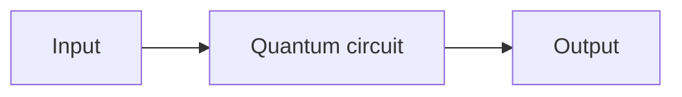
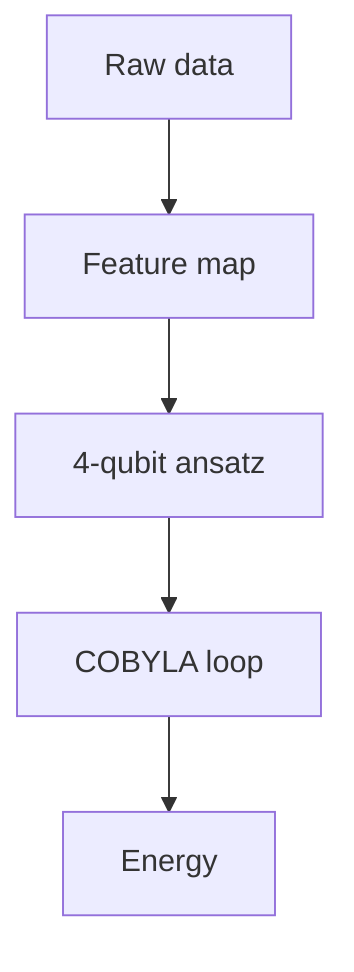

<div align="center">

# 📄 README Guide & Template

**Write a README that makes a judge want to read your work — and lets them run it.**

</div>

---

## 📌 Table of Contents

- [1. Why the README matters](#1-why-the-readme-matters)
- [2. The 60-second rule](#2-the-60-second-rule)
- [3. Anatomy of a great README](#3-anatomy-of-a-great-readme)
- [4. The template](#4-the-template)
- [5. Section-by-section guidance](#5-section-by-section-guidance)
- [6. Bad README vs good README](#6-bad-readme-vs-good-readme)
- [7. Show, don't just tell](#7-show-dont-just-tell)
- [8. Markdown tips](#8-markdown-tips)
- [9. Final checklist](#9-final-checklist)
- [10. Common mistakes](#10-common-mistakes)

---

## 1. Why the README matters

For a hackathon repository, the README **is** the submission. Judges read it
first, often in a browser tab, often alongside four other teams.

It does four jobs:

1. **Explains** what the project does and how the quantum part works.
2. **Proves** the results — with numbers, plots and tables.
3. **Enables** someone else to run it in under five minutes.
4. **Impresses** — a polished README signals a team that takes its work seriously.

> Rule of thumb: **if a judge cannot get your project running in five minutes
> from your README, they probably will not bother.**

---

## 2. The 60-second rule

A judge spends about a minute on your repo before deciding whether to dig
deeper. In that minute they must find:

| They ask | It must be in the first screen |
| :--- | :--- |
| What is this? | One-line description under the title |
| Who is this for? | Team name and team ID |
| What is the quantum part? | "Proposed Solution" section |
| Does it work? | A result: a number, a plot, a screenshot |
| How do I run it? | A `git clone` + `pip install` + run block |

Put all five **above the fold**. Everything else is detail.

---

## 3. Anatomy of a great README

```text
┌──────────────────────────────────────────────┐
│  Title  +  one-line description              │  ← identity
│  Badges (Qiskit, Python, License, Tier)      │
├──────────────────────────────────────────────┤
│  Details table (Team, ID, Tier, Repo, Links) │  ← facts
├──────────────────────────────────────────────┤
│  Table of contents (if longer than ~2 min)   │
├──────────────────────────────────────────────┤
│  Problem Statement                           │  ← what & why
│  Proposed Solution                           │  ← how
│  Approach & Architecture (diagram)           │  ← the idea
│  Tech Stack                                  │
│  Project Structure (tree)                    │
│  How to Run                                  │  ← actionable
│  How to Push Code                            │  ← team workflow
│  Results (numbers, tables, plots)            │  ← proof
│  Submission Checklist                        │  ← status
│  Resources / License                         │
└──────────────────────────────────────────────┘
```

---

## 4. The template

Copy this whole block into your `README.md` and fill in the placeholders.

````markdown
<div align="center">

# TEAM NAME

**VTU-QFF-HC-XXXX** | Tier: **Online**

</div>

---

## 👥 Team Members (GitHub IDs)

| # | Name | GitHub Username | Role |
| :- | :- | :- | :- |
| 1 | Alice | @alice | Team Lead |
| 2 | Bob | @bob | Developer |

## ❓ Problem Statement

**Problem:** _2–3 sentences._

**Why it matters:** _impact._

## 💡 Proposed Solution

**Solution:** _2–3 sentences._

**Key idea:** _one-line technical summary._

## 🧩 Approach & Architecture



1. **Input** — …
2. **Quantum core** — …
3. **Output** — …

## 🛠️ Tech Stack

| Layer | Technology |
| :- | :- |
| Language | Python 3.11+ |
| Quantum SDK | Qiskit `>=1.0`, Qiskit Aer |
| Optimisation | COBYLA / SPSA |
| Version control | Git + GitHub |

## 📁 Project Structure

```text
repo/
├── README.md
├── requirements.txt
├── src/
│   ├── circuit.py
│   └── main.py
├── notebooks/
└── tests/
```

## 🚀 How to Run

```bash
git clone https://github.com/ORG/REPO_NAME.git
cd REPO_NAME
python3 -m venv .venv && source .venv/bin/activate
pip install -r requirements.txt
python -m src.main
```

## 🔁 How to Push Code

```bash
git pull origin main
git checkout -b feature/my-task
git add . && git commit -m "feat: describe the change"
git push -u origin feature/my-task
# then open a Pull Request
```

## 📊 Results

| Metric | Quantum | Classical baseline | Notes |
| :- | :-: | :-: | :- |
| Objective value | 0.9431 | 0.9412 | higher is better |
| Circuit depth | 24 | — | |
| Shots | 4096 | — | |

_(paste a plot here)_

## ✅ Submission Checklist

- [ ] README updated with project details
- [ ] Team members listed as collaborators
- [ ] `requirements.txt` committed
- [ ] Code pushed to `main`
- [ ] Demo video linked

## 📄 License

MIT — see `LICENSE`.
````

---

## 5. Section-by-section guidance

### Title + description

One line, plain language, no jargon. Not "Quantum Optimization Suite v2" but
"**Qubit portfolio optimiser** — a VQE solver for small equity portfolios."

### Badges

Badges are optional but cheap credibility. Only include ones that are true.

```markdown


```

### Details table

Facts a judge scans for: **team name, team ID, tier, repository**. Make it a
table so it is scannable in two seconds.

### Problem Statement

State the problem **before** your solution. Two or three sentences, then why it
matters. Link to the official statement.

> ❌ "We used Qiskit to solve a problem."
> ✅ "A fund must pick 4 of 12 assets balancing return against risk. Brute force
> costs 4096 evaluations; we reduce it to a QUBO solved by a 12-qubit QAOA
> circuit with ~96 CNOT gates."

### Proposed Solution

Your solution in two or three sentences, then the **key idea** on its own
line. This is the section judges score for "quantum approach".

### Approach & Architecture

A **diagram beats a paragraph**. Mermaid renders natively on GitHub:



If Mermaid is not your style, an ASCII pipeline is fine. What matters is that
a newcomer can trace data through your code.

### Tech Stack

| Layer | Technology |
| :- | :- |
| Language | Python 3.11+ |
| Quantum SDK | Qiskit `>=1.0`, Qiskit Aer, Qiskit Runtime |
| Optimisation | COBYLA / SPSA / Adam |
| Environment | JupyterLab, `venv` |
| Version control | Git + GitHub |

### Project Structure

A `tree` block showing where things live. Keep it short — it is a map, not a
listing. Include `src/`, `notebooks/`, `tests/` and `README.md` at minimum.

### How to Run

This is the most important block in the README. It must be copy-pasteable and
work on a clean machine:

```bash
git clone https://github.com/ORG/REPO_NAME.git
cd REPO_NAME

python3 -m venv .venv
source .venv/bin/activate       # Windows: .venv\Scripts\activate

pip install --upgrade pip
pip install -r requirements.txt

python -m src.main
```

Also mention the **Python version** and any **system dependencies**
(Java for some simulators, a GPU, etc.).

### How to Push Code

Explain your team's workflow briefly and link to the
[Git & Collaboration Handbook](../vtu-hc-guide-git-and-collaboration). Keep it
to one block of commands.

### Results

**Numbers, not adjectives.** Never write "our solution performs excellently".
Write "objective value 0.9431 vs classical optimum 0.9412 (99.2% of optimal)".

Always include a **classical baseline** column — it is how judges judge whether
the quantum part helped.

### Submission Checklist

A tick-list showing the judge that you did the housekeeping. Keep it accurate.

### License

```
MIT License
Copyright (c) 2026 TEAM NAME
```

And a `LICENSE` file. Use the MIT template — it is the default for this
hackathon.

---

## 6. Bad README vs good README

### ❌ Bad

```text
# Quantum Project

This project uses quantum computing to solve optimization problems using
Qiskit framework with VQE algorithm and COBYLA optimizer implemented on
hybrid architecture with classical pre and post processing pipeline.

Code is in the folder named src and notebooks are there too. Please install
requirements and run. It works. Results are good.

Made by team.
```

**Problems:** no problem statement, no team ID, no results, no run
instructions, no structure, no claims a judge can check, no license.

### ✅ Good

```markdown
# Qubit Portfolio Optimiser

**VTU-QFF-HC-0042** | Tier: Both

Selects the 4-asset portfolio out of 12 that maximises return minus risk,
using a 12-qubit QAOA circuit on the Aer simulator.

## ❓ Problem Statement
Brute-forcing the 4096 candidate portfolios is too slow for a live decision...

## 💡 Proposed Solution
We encode the problem as a QUBO, solve it with 1-layer QAOA (p=1), and
decode the bit string back into a portfolio. A classical simulated-annealing
baseline is included for comparison.

## 📊 Results

| Metric | Quantum (QAOA) | Classical (SA) | Brute-force optimum |
| :- | :-: | :-: | :-: |
| Objective value | 0.9431 | 0.9402 | 0.9455 |
| Gap to optimum | 0.25% | 0.56% | — |
| 2-qubit gates | 96 | — | — |

## 🚀 How to Run
...
```

**Why it works:** a judge knows the problem, the approach, the numbers, the
gap to optimal, and can run it in under a minute.

---

## 7. Show, don't just tell

| Instead of | Write |
| :--- | :--- |
| "It works well" | "99.2% of the brute-force optimum across 10 test instances" |
| "Fast" | "4.2 s per run on AerSimulator, 4096 shots" |
| "Quantum advantage" | "2.1× fewer objective evaluations than simulated annealing" |
| "Good architecture" | A Mermaid diagram of the actual pipeline |
| "Clean code" | "`pytest -q` → 12 passed" |

### Assets that strengthen a README

- **Result table** — always.
- **Plot** — convergence curve, objective-vs-depth, confusion matrix.
  Commit PNGs under `docs/` and embed them:
  ```markdown
  
  ```
- **Terminal output** — in a fenced `text` block.
- **Demo GIF or video link** — 30–90 seconds is plenty.
- **Screenshot of the notebook** — only if it looks good.

> Keep images small (< 500 KB). Large assets make the repo slow to clone.

---

## 8. Markdown tips

**Task lists** — GitHub renders checkboxes, and they work in issues too:

```markdown
- [x] Repo created
- [ ] Collaborators added
```

**Inline code for file names** — `src/circuit.py`, not src/circuit.py.

**Relative links** for cross-repo links so they work if the org is renamed:

```markdown
[Git handbook](../vtu-hc-guide-git-and-collaboration)
```

**Tables for comparison**, lists for procedure.

**Emoji as section markers** — 👥 ❓ 💡 🧩 🛠️ 📁 🚀 🔁 📊 ✅ 📄. Use one per
section, not three.

**Line length** — keep prose under ~100 characters so it renders well on
GitHub.

**Code blocks with a language tag** — ```bash, ```python, ```text, ```mermaid.
Without the tag, no syntax highlighting.

**Escaping** — use `` ` `` for code, `**` for bold. If a name contains
underscores like `Ctrl_AI`, wrap it in backticks or it renders as italics.

---

## 9. Final checklist

Paste this into your README as the **Submission Checklist**:

```markdown
## ✅ Submission Checklist

- [ ] Repository created and **public**
- [ ] All team members added as **collaborators** and invitations accepted
- [ ] Team members listed in this README with their GitHub usernames
- [ ] Problem statement and proposed solution clearly described
- [ ] Quantum approach explained (with a diagram)
- [ ] `requirements.txt` committed with pinned versions
- [ ] `git clone` → `pip install` → run works on a clean machine
- [ ] Results table included, with a classical baseline
- [ ] Tests included and passing (`pytest -q`)
- [ ] Notebooks committed with outputs cleared
- [ ] Demo video or live demo slot confirmed
- [ ] `LICENSE` file added
- [ ] Latest changes merged into `main`
```

---

## 10. Common mistakes

| Mistake | Fix |
| :--- | :--- |
| README says "private repo" | The repos are public — remove the line |
| Clone URL points to a bare repo name | Use the full URL: `https://github.com/ORG/REPO.git` |
| "Repo created and private" in the checklist | Change to "public" |
| No team ID | Add `VTU-QFF-HC-XXXX` under the title |
| No results section | Add a table with a classical baseline |
| `pip install` fails | Pin versions in `requirements.txt`; test in a fresh venv |
| Run command not documented | Add a copy-pasteable block |
| Screenshots of terminal output only | Add a results table too |
| Broken relative links | Check them after pushing |
| Placeholder text left in | Search for `_`, `TODO`, `XXX`, `Lorem` |
| Nothing about the quantum part | Add a dedicated section and a diagram |

---

<div align="center">

**VTU-QFF Guide** · README Guide & Template
· Part of the [VTU-QFF Hackathon](https://github.com/vtu-qiskit-fall-fest-2026)

[⬆ Back to Top](#-readme-guide--template)

</div>
